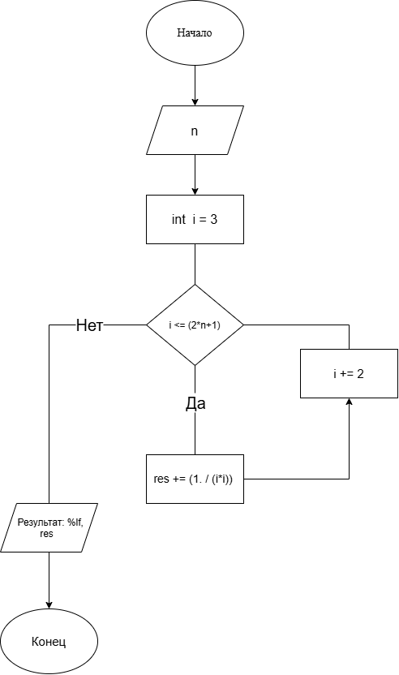

# Домашнее задание к работе номер 8

## Условие задачи

Вычислите с использованием цикла for значение для заданного n.

## 1. Алгоритм и блок-схема

### Алгоритм

1. Начало.

2. Объявить переменную **n**

3. Составить цикл for для нахождения значения выражения.

4. Конец.

### Блок-схема



## 2. Реализация программы

```c
#define _CRT_SECURE_NO_WARNINGS
#include <stdio.h>
#include <locale.h>

void main() {
    setlocale(LC_CTYPE, "RUS");
    double n;
    double res = 0;
    puts("введите n");
    scanf("%lf", &n);
    for (int i = 3; i <= (2*n+1); i += 2) {
        res += (1. / (i*i));
    }
    printf("Результат: %lf", res);
}
```

## 3. Результаты работы программы

Пример:\
введите n\
10\
Результат: 0.210989

## 4. Информация о разработчике

Литуновский Максим Дмитриевич, бТИИ-261
